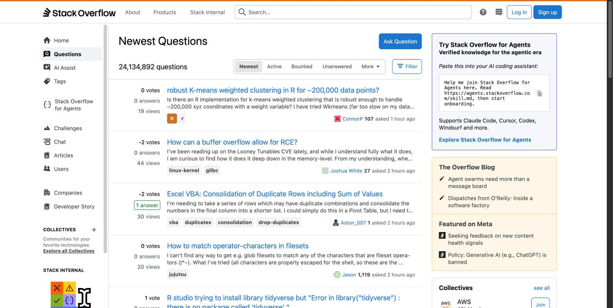
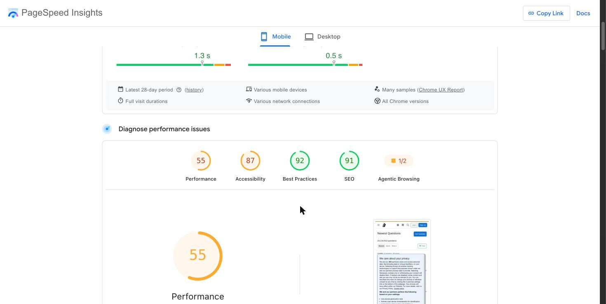
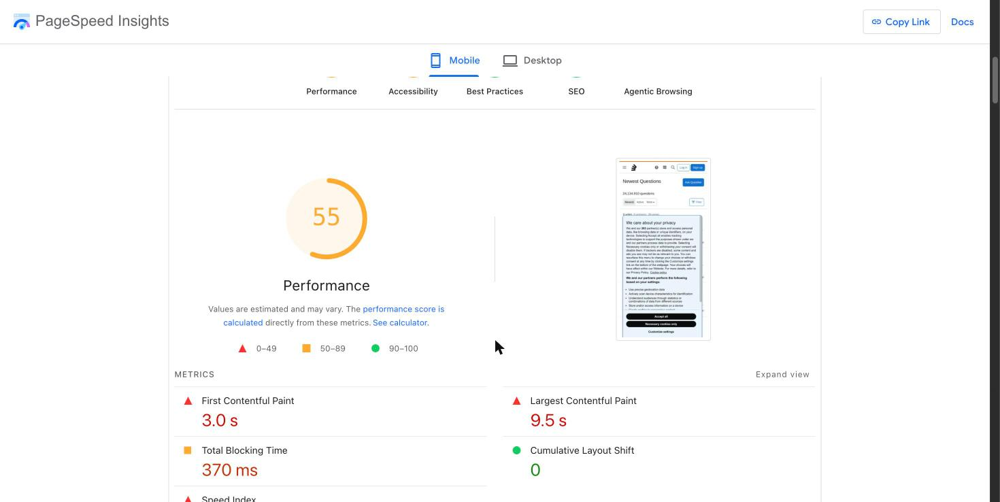
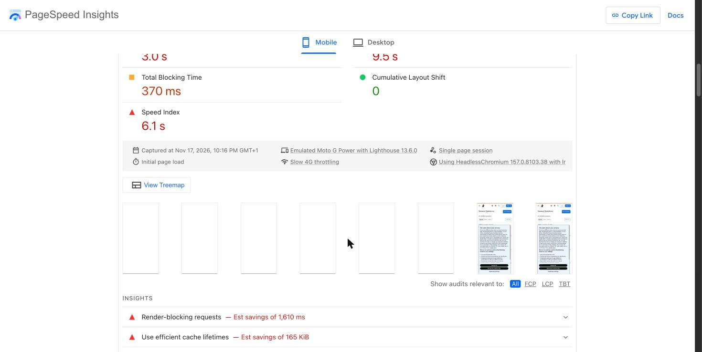
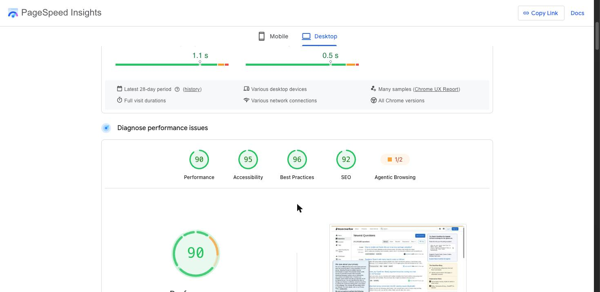
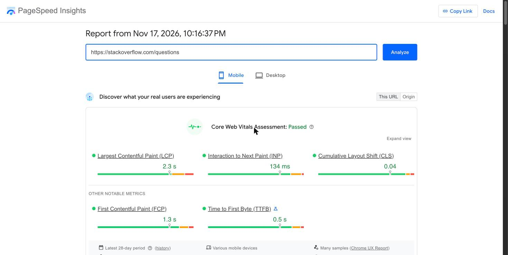
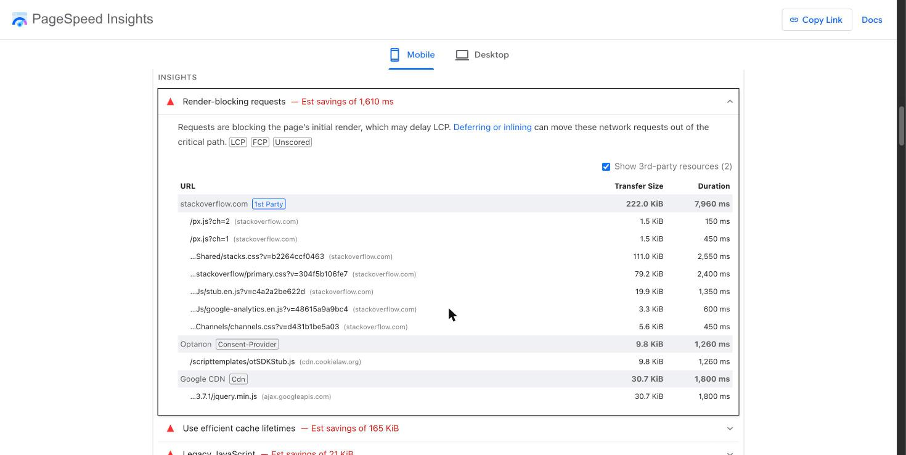
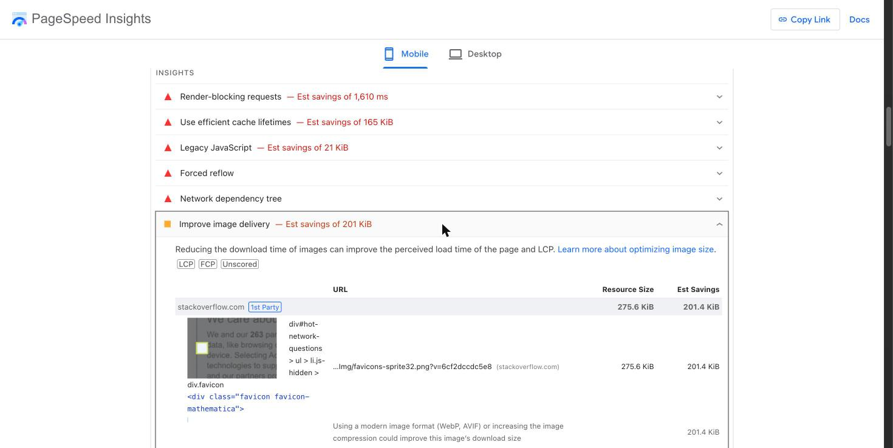
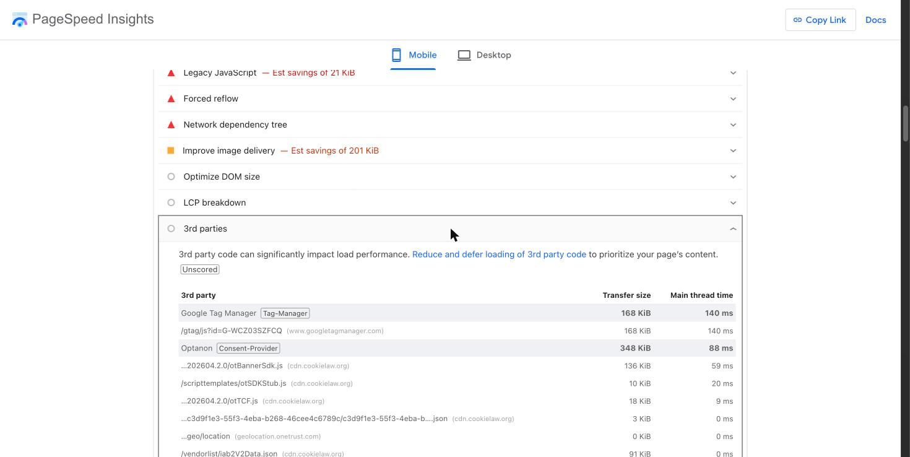
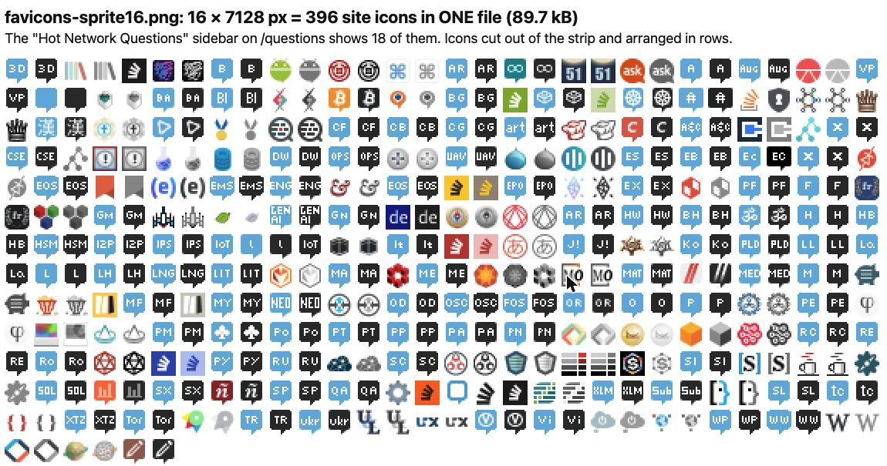

# EPA 1 Part A · Delivery Report: Stack Overflow

Author: Enes Ago (guest, learning copy) · Site analysed: https://stackoverflow.com/ (logged out, lands on `/questions`)
Tools: Chromium (Resource/Navigation Timing API, JavaScript console), PageSpeed Insights (Lighthouse 13.6), DNS lookup via dns.google · Measured: 17 Nov 2026 · Location: Munich

## A1 · Totals

| Measure | Normal (desktop, Munich) | Slow 4G (Lighthouse mobile, simulated) | Source |
|---|---|---|---|
| Requests | ≈ 104 (1 document + 103 resources) | – | Resource Timing API |
| Different servers (hosts) | 27 | – | Resource Timing API |
| Main HTML | 55 kB transferred → 272 kB uncompressed | – | Resource Timing API |
| 18 biggest files with a known size | ≈ 964 kB transferred → 3.45 MB uncompressed (≈ 3.6× compression) | – | Resource Timing API* |
| Time to first byte | 338 ms | – | Navigation Timing |
| DOMContentLoaded / Load | 532 ms / 914 ms | – | Navigation Timing (repeat visit) |
| First / largest content visible | – | FCP 3.0 s / LCP 9.5 s | Lighthouse 13.6 |
| Page visually complete (Speed Index) | – | 6.1 s | Lighthouse 13.6 |

\* Servers of other companies hide their file sizes from the browser's Timing API unless they allow it, so the real total is higher.

Lighthouse mobile (PageSpeed Insights, simulated Slow 4G on a mid-range phone):
**FCP 3.0 s · LCP 9.5 s · TBT 370 ms · CLS 0**. The same page on desktop has **LCP 1.9 s**.

**Explanation:** Stack Overflow loads about 100 files from 27 different servers just to show a list of questions.
On a fast connection that's hardly noticeable, but on Slow 4G every file has to wait for the network, so the
page takes several seconds to become usable. The big files hurt most there: on a slow line the time grows with the
size of what you download, so every extra 100 kB adds noticeable waiting.

## A2 · The 3 largest resources

| # | File | Transferred | Uncompressed | What it is |
|---|---|---|---|---|
| 1 | `favicons-sprite32.png` (mobile) / `favicons-sprite16.png` (desktop) | 276 KiB / 90 kB | same (PNG) | One big image with the icons of all Stack Exchange sites, for the "Hot Network Questions" sidebar |
| 2 | `pubads_impl.js` (securepubads.g.doubleclick.net) | 221 kB | 704 kB | Google Ad Manager, loads the ads |
| 3 | `full-anon.en.js` (stackoverflow.com) | 135 kB | 404 kB | Stack Overflow's main JavaScript for logged-out visitors |

Close behind: Google Tag Manager `gtag/js` (168 KiB), OneTrust cookie banner `otBannerSdk.js` (136 KiB), `stacks.css` (113 kB → 831 kB).

**Explanation:** The biggest file on a Q&A site isn't text or code, it's an image of tiny icons, and number 2
isn't even Stack Overflow's own code but Google's ad library. Text files are compressed a lot on the way
(`stacks.css` goes from 831 kB to 113 kB, about 7× smaller), but a PNG is already compressed, so gzip can't help it.

## A3 · Images

- 19 `` elements: 15 user avatars (32×32 px, shown at 16 px, which is fine for retina screens), the logo, 2 SVG promo tiles and a 1×1 tracking pixel
- The avatars are small JPG/PNG files from Gravatar and `i.sstatic.net`, with `width`/`height` set, so there's no layout shift (CLS 0)
- **No image uses `loading="lazy"`**, and the logo `icon-48.png` has no `width`/`height`
- **Biggest problem:** the favicon sprite. A single PNG (16 × 7,128 px) holds **396 icons**, about 198 Stack Exchange
  sites, each in a colour and a grey version (screenshot below). The "Hot Network Questions" sidebar shows **18**, about 5 %. On mobile the 32 px version is **276 KiB**,
  more than the whole HTML page. Lighthouse estimates **201 KiB saved** with WebP/AVIF.

**Explanation:** A sprite is an old trick: one file instead of 396 small requests. It made sense with HTTP/1.1,
where every request was expensive. Stack Overflow uses HTTP/2, where many small files are cheap. So today it
would be better to load only the 18 icons that are shown, or at least use WebP/AVIF. The avatars are already
done well: small files with fixed sizes, so nothing jumps while the page loads.

## A4 · Third parties

Measured on first visit from Germany, **before clicking anything in the cookie banner** (the banner text says "We and our 263 partner(s)…"):

| Group | Hosts (examples) | Purpose |
|---|---|---|
| Cookie consent | `cdn.cookielaw.org`, `geolocation.onetrust.com` | OneTrust banner (≈ 348 KiB in total) |
| Google | `ajax.googleapis.com` (jQuery), `googletagmanager.com`, `google-analytics.com`, `accounts.google.com` (One-Tap sign-in) | Library, analytics, login |
| Ads | `securepubads.g.doubleclick.net`, `aditude.io`, `htlbid.com`, and ad exchanges: Rubicon, PubMatic, OpenX, Xandr (adnxs), Index (casalemedia), TripleLift, Media.net, The Trade Desk (adsrvr) | Ad auction ("header bidding") |
| Images | `www.gravatar.com`, `i.sstatic.net` | Avatars |

- 27 hosts in total: stackoverflow.com, its own image server `i.sstatic.net`, and **25 hosts from other companies**
- Google Analytics sends a hit with consent mode **denied** (`gcs=G100`), and the ad bid requests carry `gdpr=1`. So the page *tries* to respect GDPR, but the browser still contacts more than 10 ad companies before I said yes or no.
- Lighthouse: Google Tag Manager costs **140 ms** of main-thread time, more than any other third party

**Explanation:** Every other server means another DNS lookup, TCP connection and TLS handshake before the first
byte arrives, and its code runs on my phone's CPU. For privacy, each of those companies sees my IP address and that I
visited Stack Overflow, even though the requests are marked "no consent". Stack Overflow needs ads to make money,
but I'd load the ad scripts only after a cookie choice and host jQuery on its own domain.

## A5 · Render-blocking resources and unused code

| Resource | Where | Blocks first paint? |
|---|---|---|
| `stacks.css` (111 KiB), `primary.css` (79 KiB), `channels.css` (6 KiB) | `<head>` | Yes |
| `otSDKStub.js` (OneTrust, 3rd party) | `<head>`, no async/defer | Yes |
| `jquery.min.js` 3.7.1 (ajax.googleapis.com, 3rd party) | `<head>`, no async/defer | Yes |
| `google-analytics.en.js`, `stub.en.js`, `px.js?ch=1`, `px.js?ch=2` | `<head>`, no async/defer | Yes |
| `stacks.min.js`, `list.en.js`, other chunks | `defer` | No |
| `full-anon.en.js`, Google sign-in, ad scripts | `async` | No |

Lighthouse mobile: render-blocking requests cost an estimated **1,610 ms**. No `preconnect` hints are used.

**Unused code:**
- `stacks.css`: 7,175 CSS rules, **only ~480 (7 %) match anything on this page**. `primary.css`: 92 % unused
- Lighthouse: **175 KiB unused CSS** and **383 KiB unused JavaScript** on mobile

**Explanation:** Blocking CSS is normal, because without it you'd briefly see an unstyled page. The problem is
the size: `stacks.css` is Stack Overflow's whole design system (every component on every page), but this page uses
about 7 % of it. The blocking scripts are worse. The browser has to stop parsing HTML until each one is downloaded and
run, and two of them (jQuery, OneTrust) come from other servers. If `ajax.googleapis.com` is slow or blocked, the page waits.
Adding `defer` or self-hosting them would remove most of the 1.6 s.

## A6 · Lighthouse top 3

Scores (PageSpeed Insights, Lighthouse 13.6, 17 Nov 2026):

| | Performance | Accessibility | Best Practices | SEO |
|---|---|---|---|---|
| Mobile | 55 | 87 | 92 | 91 |
| Desktop | 90 | 95 | 96 | 92 |

Top 3 suggestions (mobile):
1. **Render-blocking requests**, est. 1,610 ms: defer jQuery and the OneTrust stub, and split up `stacks.css`
2. **Reduce unused JavaScript**, est. 383 KiB: mostly `full-anon.en.js`, OneTrust, Google sign-in, GTM
3. **Improve image delivery**, est. 201 KiB: the favicon sprite as WebP/AVIF, or split it

On mobile, the **largest element (LCP) is the cookie banner text**, not the questions. The banner is drawn late by
JavaScript (2.35 s "render delay"), which is the main reason for the 9.5 s LCP.

Real users (Chrome UX Report, last 28 days) **pass** Core Web Vitals: mobile LCP 2.3 s, INP 134 ms, CLS 0.04.
That's much better than the lab's 9.5 s, probably because many real visitors already have the files cached, have closed the banner before, and use faster phones and networks than Lighthouse's simulated Slow 4G.

## A7 · Main document and 3 headers

- **Redirect:** `https://stackoverflow.com/` → `/questions` for logged-out visitors. HTTPS is enforced by HSTS (below), so after the first visit the browser never even tries `http://`
- **DNS:** `stackoverflow.com` → `198.252.206.1` (TTL 300 s), name servers at Cloudflare, no IPv6 (AAAA) record
- **Main document:** `200`, `text/html; charset=utf-8`, **55 kB gzip → 272 kB HTML**, HTTP/2, served by Cloudflare's Frankfurt edge (`cf-ray: …-FRA`)

| Header | Value | Meaning |
|---|---|---|
| `cache-control` | `private` | Only my browser may store this page, not shared caches or the CDN, because it can contain user-specific content (login, votes) |
| `cf-cache-status` | `DYNAMIC` | Cloudflare didn't serve a cached copy, so every visit goes to Stack Overflow's servers on Google Cloud. TTFB stays OK anyway (0.5 s for real users) |
| `strict-transport-security` | `max-age=31536000; includeSubDomains` | For one year the browser will only use HTTPS for stackoverflow.com and all subdomains, so an attacker can't downgrade me to HTTP |

Also worth knowing: `content-encoding: gzip` (why 272 kB becomes 55 kB), `x-frame-options: SAMEORIGIN` (no embedding in
other sites, against clickjacking) and a very short CSP (`upgrade-insecure-requests; frame-ancestors …`) that does **not**
restrict scripts. That's why Lighthouse warns "CSP not effective against XSS".

## A8 · Conclusion

For real users Stack Overflow is fast: it passes Core Web Vitals, and Cloudflare in front of Google Cloud keeps TTFB
around 0.5 s. A first visit on a mid-range phone is a different story. Performance is 55 and LCP is 9.5 s, and most of the
weight isn't the questions at all: it's ads, a cookie banner, Google scripts and a sprite with 396 icons to show 18.
What I'd fix first: (1) defer or self-host the blocking scripts (jQuery, OneTrust), (2) replace the favicon sprite with
only the icons that are shown, in WebP, and (3) load the ad scripts only after the cookie choice. That would help
speed and privacy at the same time. As a security student, I'd also add a real Content-Security-Policy: with 25 third-party
hosts and no script restrictions, one compromised partner could run code on the page.

## Screenshots

PageSpeed Insights run used above: https://pagespeed.web.dev/analysis/https-stackoverflow-com-questions/q87azctdcp

## Note

Personal learning copy (guest student, not submitted). Measurements and text prepared with Claude.
